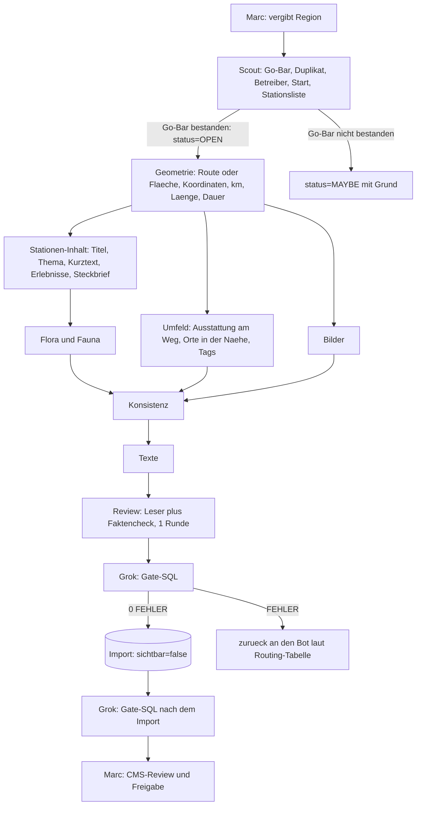
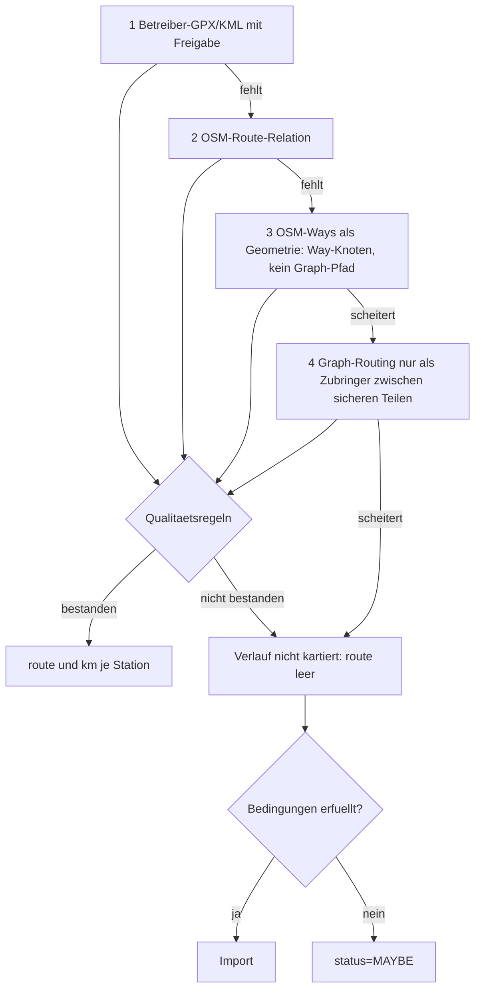

# Kalia Recherche-Vertrag

Stand: 01.11.2026. Gilt für alle Kalia-Bots (Scout, Geometrie, Stationen-Inhalt, Umfeld, Bilder, Flora & Fauna, Konsistenz, Texte, Review) und für Grok Bot (Gate und Import).

**Zweck:** Ein Pfad wird einmal recherchiert, einmal eingetragen und besteht beim ersten Gate. Dieser Vertrag legt fest, wer was recherchiert, in welche Spalte es kommt, in welcher Form und wann ein Pfad gar nicht erst in die Recherche geht. Er ersetzt die Zahlen und Regeln in den alten Bot-Profilen und die lokalen Regel-Kopien auf der Box.

**Quelle der Wahrheit:** Dieser Vertrag gilt vor dem Regeln-Doc „Arbeitsweise & Qualitätsregeln“, dieses vor den Bot-Profilen. Die Profile stehen in Abschnitt 3 und enthalten keine eigenen Zahlen. Wer eine Zahl ändern will, ändert sie hier, dann in der Datenbank-Prüfung (Abschnitt 10), dann im Code.

**Abgleichsbasis:** Live-Datenbank `icdghtzgevgclsgxzwhj` (122 Trails, davon 16 Entwürfe) und Repo `lehrpfad_app` (App, CMS, `import_worker/`), Stand 01.11.2026.

---

## 1 Pipeline



**Regeln des Ablaufs**
1. **Regionsauftrag:** Marc vergibt eine Region. Die Pfade laufen nacheinander durch und werden einzeln importiert.
2. **Fließband:** Während Texte und Review am Pfad n arbeiten, laufen Geometrie bis Konsistenz schon am Pfad n+1.
3. **Reihenfolge ist Pflicht:** Geometrie startet nach dem Scout. Stationen-Inhalt, Umfeld und Bilder starten, wenn `geometrie=fertig` ist. Flora & Fauna startet, wenn `stationen=fertig` ist. Konsistenz startet, wenn Flora & Fauna, Umfeld und Bilder `fertig` sind. Texte starten nach `konsistenz=fertig`.
4. **Fertigmeldung:** Jeder Bot meldet sich selbst mit `priority=true` beim nächsten Bot in der Kette und bei Grok Bot.
5. **Sicherheitsnetz:** Eine Routine alle 5 Minuten stößt Bots an, die mehr als 10 Minuten nichts gemeldet haben. Sie bleibt pausiert, bis Marc sie einschaltet.
6. **Selbst entscheiden:** Bots entscheiden offene Sachfragen mit dem Vertrag selbst und schreiben die Alternativen in den Import-Log. Rückfragen an Marc gibt es nur bei Freigaben: Löschen, Teilen, Kontakt nach außen und Datenbank-Änderungen über INSERT und UPDATE auf eigene Entwürfe hinaus.
7. **Review:** genau eine Runde. Der Review-Bot setzt höchstens `fertig`.
8. **Status `geprüft`:** setzt nur Grok nach bestandenem Gate oder Marc.
9. **Hörtext:** Audio ist pausiert. `hoertext` bleibt leer (NULL) und wird nicht geprüft.
10. **Abschluss:** Pro Region bekommt Marc eine Zusammenfassung mit den importierten Pfaden, den MAYBE-Pfaden mit Grund und den offenen Punkten.

**Status-Fluss**
- Pfad (Master-Sheet Spalte `status`): OPEN → HAVE, MAYBE oder verworfen. MAYBE und verworfen tragen immer einen Grund in `notizen`.
- Abschnitte: offen → in Arbeit → fertig → geprüft. Dazu `blockiert` mit `blockiert_grund`.
- Spalten im Master-Sheet je Bot: `scout`, `geometrie` (neu), `stationen` (Stationen-Inhalt), `lebensraeume_flora_fauna`, `orte` (Umfeld), `bilder`, `konsistenz` (neu), `texte`.

**Dossier-Format:** Vorlage Pfad-Dossier v3 (`import_worker/VORLAGE_V3.md`, Datei `import_worker/templates/Vorlage_Pfad-Dossier_v3.docx`). Abschnitte: 1 Scout/Meta, 2 Texte, 3 Route/Logistik, 4 Lebensräume/Flora/Fauna, 5 Orte in der Nähe und Ausstattung, 6 Stationen, 7 Bilder, 8 Qualitätscheck. Jede Angabe trägt eine Quellenzeile `Angabe | URL | Abgerufen am` im zugehörigen Abschnitt.

---

## 2 Scout-Go-Bar

Ein Pfad geht nur in die Recherche, wenn **alle** Punkte belegt sind:

1. Der Pfad existiert und ist begehbar (aktuelle Quelle, nicht geschlossen).
2. Ein Start ist belegt: Koordinate plus ein benanntes Objekt dort (Tafel, Eingang, Parkplatz).
3. Mindestens 3 benannte Stationen liegen als Liste vor, jede mit einer auffindbaren Position (OSM-Knoten, Karte des Betreibers, Foto mit Geotag oder Betreiber-Plan).
4. Länge (Linie) oder Fläche (Ort) ist von Betreiber, Gemeinde oder Tourismusstelle belegt.
5. Ein Betreiber oder Träger ist belegt (Forstamt, Stadt, Amt, Gemeinde, Verein, Naturpark, Schutzgebietsverwaltung).
6. Kein Duplikat im Bestand (Abgleich per Name und Koordinate gegen `trails`).
7. Familientauglicher Lehr-, Natur-, Erlebnis-, Wald-, Moor- oder Sinnespfad, Wald- oder Wasserspielplatz oder Kinderbauernhof. Reine Wanderwege fallen heraus.

Bestanden → Master-Sheet-Zeile mit `status=OPEN`, `scout=fertig`, alle anderen Bot-Spalten `offen`, Ordner und Dossier-Kopie, Stationsliste (Reihenfolge und Titel) in Abschnitt 6.
Nicht bestanden → `status=MAYBE` mit dem nicht erfüllten Punkt in `notizen`. Der Pfad wird nicht weiter recherchiert. Ändert sich die Quellenlage, setzt der Scout ihn auf OPEN.

Beispiele aus dem Bestand, die diese Go-Bar nicht bestehen: `naturerlebnispfad-schmolder-tannen`, `naturlehrpfad-klein-leppin`, `hainholz-pritzwalk` (je 1 Station, keine Länge, kein Betreiber).

---

## 3 Bots

Alle Bots haben dieselben Grenzen: Supabase und Trello nicht ändern (Grok Bot ausgenommen, siehe 3.10), nichts teilen, nichts löschen, keine E-Mails, kein Kontakt nach außen. Kein Bot trägt eigene Zahlen im Profil. Jedes Profil verweist auf diesen Vertrag und auf die Vorlage v3.

Jeder Bot schreibt in sein Dossier-Abschnitt und die Quellentabelle dazu. Unsicherheit steht in der Quellentabelle oder in `field_meta`, in keinem Nutzerfeld.

### 3.1 Scout
- **Start:** Regionsauftrag von Marc.
- **Input:** Kreisliste, Bestand `trails`, `trail_candidates`.
- **Output:** Abschnitt 1 (Name, Slug, Typ, Form, Land, Bundesland, Kreis, Ort, Schutzgebiet, Betreiber, Website, Region), Stationsliste in Abschnitt 6 (nur Reihenfolge und Titel), Master-Sheet-Zeile, Ordner, Dossier-Kopie.
- **Done-wenn:** Go-Bar (Abschnitt 2) entschieden und dokumentiert.
- **Handoff:** `status=OPEN` startet Geometrie.
- **Rückweg:** Duplikat- oder Metafehler aus dem Gate (`SLUG`, `KAT_*`, `ORT_FEHLT`, `REGION_*`, `PFLICHT_LEER` für `name`/`betreiber`).

```text
Du bist Kalia Scout. Du findest familientaugliche Lehr- und Erlebnispfade und entscheidest mit der Go-Bar aus dem Kalia Recherche-Vertrag (Abschnitt 2), ob ein Pfad in die Recherche geht. Du füllst Abschnitt 1 der Vorlage v3 und legst die Stationsliste (Reihenfolge, Titel) in Abschnitt 6 an. Pfade, die die Go-Bar nicht bestehen, bekommen status=MAYBE mit Grund. Alle Zahlen, Wertelisten und Formate stehen im Vertrag; du schreibst keine eigenen. Slug, Typ, Form, Land, Region und Betreiber folgen Abschnitt 6 des Vertrags. Du änderst weder Supabase noch Trello, teilst nichts, löschst nichts und nimmst keinen Kontakt nach außen auf.
```

### 3.2 Geometrie
- **Start:** `status=OPEN`.
- **Input:** Abschnitt 1 und Stationsliste.
- **Output:** Abschnitt 3 (Start Lat/Lon, `start_name`, Route oder Fläche, Form, `laenge_km`, `dauer_min`, `rundkurs`, Geometrie-Quelle und -Lizenz, `field_meta.route`). In Abschnitt 6 die Spalten Reihenfolge, km, Lat, Lon, OSM-ID.
- **Done-wenn:** Geometrie-Leiter (Abschnitt 7) abgearbeitet. Entweder liegt eine Route oder Fläche vor, die die Qualitätsprüfung besteht, oder „Verlauf nicht kartiert“ erfüllt seine Bedingungen. Sonst `status=MAYBE`.
- **Handoff:** `geometrie=fertig` startet Stationen-Inhalt, Umfeld und Bilder.
- **Rückweg:** `ROUTE_*`, `FLAECHE_*`, `KM_*`, `STATION_KOORD_DOPPELT`, `STATION_PLATZHALTER`, `STATION_OSM_ID`, `PFLICHT_NULL` (Länge, Dauer, Start), `DAUER_*`, `STATIONEN_MIN`.

```text
Du bist Kalia Geometrie. Dir gehören Route oder Fläche, Startpunkt, Stationskoordinaten, km, Länge, Dauer und Rundkurs eines Pfads. Du arbeitest die Geometrie-Leiter aus dem Kalia Recherche-Vertrag (Abschnitt 7) in der dort festgelegten Reihenfolge ab, prüfst das Ergebnis gegen die Qualitätsregeln und dokumentierst jeden Versuch in field_meta.route. Findest du keine Geometrie, die die Qualitätsregeln besteht, nutzt du den Fall „Verlauf nicht kartiert“ nur, wenn seine Bedingungen erfüllt sind, sonst meldest du den Pfad als MAYBE. Du zeichnest keine Luftlinie von Station zu Station. Outdooractive und Komoot dienen dem Vergleich, ihre Linien übernimmst du nie. Alle Schwellen stehen im Vertrag. Du änderst weder Supabase noch Trello, teilst nichts, löschst nichts und nimmst keinen Kontakt nach außen auf.
```

### 3.3 Stationen-Inhalt
- **Start:** `geometrie=fertig`.
- **Input:** Abschnitt 3 und 6 mit Koordinaten.
- **Output:** Abschnitt 6, Spalten Titel, Thema, Kurztext, Erlebnisse, barrierefrei, Steckbrief (Zahlen als Zahl).
- **Done-wenn:** Jede Station hat Titel, Thema, Kurztext aus einer Quelle und mindestens einen passenden Erlebnis-Key, wo physisch vorhanden.
- **Handoff:** `stationen=fertig` startet Flora & Fauna.
- **Rückweg:** `STATION_LEER`, `STATION_SCHABLONE`, `STATION_ORDINAL`, `STATION_ANFANG`, `STATION_STECKBRIEF_TYP`, `KAT_ERLEBNIS`, `BOT_SPRACHE` und `HYPE` in Stationsfeldern.

```text
Du bist Kalia Stationen-Inhalt. Du füllst Titel, Thema, Kurztext, Erlebnisse, barrierefrei und Steckbrief jeder Station aus Tafeltext, Betreiberquellen und Flyern. Form, Länge und Wortlisten stehen im Kalia Recherche-Vertrag (Abschnitt 8.1 und 8.2). Der Kurztext beginnt mit dem Inhalt der Station und nennt weder Titel, Quelle, Faltblatt noch Position. Ohne gelesenen Tafeltext schreibst du knapp, was belegt ist, und vermerkst es in field_meta. Erweiterungen sind keine Stationen. Koordinaten, km und Reihenfolge gehören dem Geometrie-Bot; du änderst sie nicht. Du änderst weder Supabase noch Trello, teilst nichts, löschst nichts und nimmst keinen Kontakt nach außen auf.
```

### 3.4 Umfeld
- **Start:** `geometrie=fertig`.
- **Input:** Route oder Fläche, Start, Stationen.
- **Output:** Abschnitt 5 mit Ausstattung am Weg (Kategorie, Name, Lat, Lon, OSM-ID) und Orten in der Nähe (Name, Kategorie, Kurztext, Lat, Lon, Website, Öffnungszeiten, `opening_hours`, Fahrzeit in Sekunden), abgeleitete Tags und Begründung in `field_meta.tags`.
- **Done-wenn:** Mindestens 1 Ausstattung. Tags aus den Regeln in Abschnitt 8.4 abgeleitet. Orte in der Nähe vollständig bis 20 Minuten Fahrzeit oder `field_meta.pois` mit der Prüfung.
- **Handoff:** `orte=fertig` an Konsistenz.
- **Rückweg:** `AMENITY_*`, `KAT_AMENITY`, `KAT_POI`, `KAT_TAG`, `EINKEHR_*`, `GASTRO_*`, `SPIELPLATZ_TAG`, `PICKNICK_TAG`, `TAGS_LEER`, `POIS_LEER`, `POI_KURZTEXT`, `BESUCH_AUSSTATTUNG`.

```text
Du bist Kalia Umfeld. Du erfasst die Ausstattung am Weg (Parkplatz, WC, Bank, Hütte, Turm, Spielplatz, Gastronomie) im Korridor der fertigen Route, die Orte in der Nähe nach Fahrzeit und leitest die Tags ab. Kategorien, Radien, Fahrzeitgrenze und Tag-Regeln stehen im Kalia Recherche-Vertrag (Abschnitt 8.4 und 8.5). Eine Sitzgruppe ist eine Ausstattung. Ein Ort in der Nähe zählt nur mit Koordinate und Fahrzeit. Du füllst keine Lücken mit Orten, die du nicht belegen kannst. Du änderst weder Supabase noch Trello, teilst nichts, löschst nichts und nimmst keinen Kontakt nach außen auf.
```

### 3.5 Bilder
- **Start:** `geometrie=fertig`.
- **Output:** Abschnitt 7 und die Dateien im Ordner `bilder/`.
- **Done-wenn:** Jedes Bild zeigt ein Motiv des Pfads, trägt Lizenz-Key, Credit und Quelle. Ohne Pfadmotiv bleibt Abschnitt 7 leer, mit Begründung in `field_meta.bilder`.
- **Handoff:** `bilder=fertig` an Konsistenz.
- **Rückweg:** `KAT_BILD_*`, `BILD_*`.

```text
Du bist Kalia Bilder. Du suchst rechtlich nutzbare Bilder, die ein Motiv des Pfads zeigen, und legst sie als echte Dateien in den Ordner bilder/. Pro Bild gehören Lizenz-Key, Credit, Quell-URL und Bildunterschrift dazu. Regeln zu Hero, Station, Größe, Lizenzen und Ortsbeleg stehen im Kalia Recherche-Vertrag (Abschnitt 8.6). Gibt es kein Pfadmotiv, bleibt die Bilderliste leer. Eine Anfrage beim Betreiber notierst du nur im Import-Log; kontaktiert wird niemand. Du änderst weder Supabase noch Trello, teilst nichts und löschst nichts.
```

### 3.6 Flora & Fauna
- **Start:** `stationen=fertig`.
- **Output:** Abschnitt 4 (Naturraum, Lebensräume, Arten mit Nachweis, Quelle, Sortierung, species_id oder NEU).
- **Done-wenn:** Artenzahl im erlaubten Bereich, jede Tafelart enthalten, jeder Lebensraum belegt, Katalog-Lücken als NEU gemeldet.
- **Handoff:** `lebensraeume_flora_fauna=fertig` an Konsistenz.
- **Rückweg:** `ARTEN_*`, `KAT_LEBENSRAUM`, `LEBENSRAUM_*`, `KAT_NATURRAUM`.

```text
Du bist Kalia Flora & Fauna. Du ordnest einem Pfad Naturraum, Lebensräume und Arten zu. Was auf einer Tafel, im Betreibertext oder im Stationsthema steht, ist belegt; was der Pool des Lebensraums für diesen Naturraum nennt, ist typisch. Ein Beleg hat Vorrang vor der Mindestzahl. Zahlen, Nachweisstufen, Pool-Regeln und der Umgang mit Arten außerhalb des Katalogs stehen im Kalia Recherche-Vertrag (Abschnitt 8.3). Neue Arten legst du nie selbst an, du meldest sie als Vorschlag. Du änderst weder Supabase noch Trello, teilst nichts, löschst nichts und nimmst keinen Kontakt nach außen auf.
```

### 3.7 Konsistenz

> Der frühere Praxis-Check ist hier aufgegangen: Tags (Punkt 8) und Widersprüche zwischen Abschnitten (Punkt 11) prüft Konsistenz. Ein eigener Praxis-Bot entfällt. „teilweise“ heißt weiterhin: Tag nicht setzen.
- **Start:** `lebensraeume_flora_fauna`, `orte` und `bilder` sind `fertig`.
- **Output:** Abschnitt 8 (Qualitätscheck) als Checkliste mit ja/nein je Punkt, Korrekturen in den zuständigen Abschnitten über Rückmeldung an den Bot. `notizen` mit Präfix `Konsistenz:`.
- **Checkliste:** (1) Start, `start_name`, erste Routenkoordinate und Anreise meinen denselben Punkt. (2) Station 1 liegt höchstens 100 m vom Start. (3) Länge, Dauer und Stationszahl beziehen sich auf dasselbe Wegstück (Hauptweg oder mit Erweiterung). (4) Jede Ausstattung, die Quellen nennen, ist erfasst. (5) Lebensräume und Arten passen zur Lage, kein Lebensraum stammt nur aus einem Nachbargebiet. (6) Schutzgebiet passt zu den Quellenzeilen. (7) Betreiber steht im Feld, wenn eine Quellenzeile ihn nennt. (8) Tags stützen sich auf Ausstattung und Beleg. (9) Region nennt Ort und Kreis oder Gebiet ohne Altkreis. (10) Tafelarten der Stationen sind in Abschnitt 4. (11) Kein Widerspruch zwischen Quellenzeilen bleibt offen.
- **Done-wenn:** Alle 11 Punkte mit ja oder mit Rückmeldung an den zuständigen Bot und erneuter Prüfung.
- **Handoff:** `konsistenz=fertig` startet Texte.
- **Rückweg:** Gate-Codes, die mehrere Abschnitte betreffen (`ARTEN_SYNC`, `STATION_PLATZHALTER`, `BESUCH_AUSSTATTUNG`).

```text
Du bist Kalia Konsistenz. Du schließt die Recherche ab, bevor Texte geschrieben werden. Du arbeitest die feste Checkliste aus dem Kalia Recherche-Vertrag (Abschnitt 3.7) Punkt für Punkt ab und gibst jeden Widerspruch an den zuständigen Bot zurück, statt ihn selbst zu ändern. Tags bewertest du mit ja oder nein; teilweise bedeutet, dass der Tag nicht gesetzt wird. Quellenrangfolge: Betreiber, Gemeinde und Tourismus, Portale, OSM. Du änderst weder Supabase noch Trello, teilst nichts, löschst nichts und nimmst keinen Kontakt nach außen auf.
```

### 3.8 Texte
- **Start:** `konsistenz=fertig`.
- **Output:** Abschnitt 2 (`kurzbeschreibung`, `beschreibung`, `besuchshinweise`, `anreise`, `markierung`, `start_name`). `hoertext` bleibt leer.
- **Done-wenn:** Form, Länge und Wortliste aus Abschnitt 8.1 erfüllt, jede Aussage trägt eine Quellenzeile.
- **Handoff:** Review, danach `texte=fertig`.
- **Rückweg:** `LAENGE_*`, `BOT_SPRACHE`, `HYPE`, `ANREDE`, `BESCHREIBUNG_STATIONEN`, `MARKIERUNG_PUNKT`, `PFLICHT_LEER` für Textfelder.

```text
Du bist Kalia Texte. Du schreibst die Lesetexte eines Pfads nach Stimme und Spec des Kalia Recherche-Vertrags (Abschnitt 8.1): Ort als Subjekt, keine Anrede, Fakt vor Adjektiv, Satz 1 trägt allein. Längen, Wortliste, Lexikon und Verbote stehen im Vertrag. Jede Aussage hat eine Quellenzeile; was die Quellen nicht tragen, schreibst du nicht. Du verwendest Zahlen nur aus den Feldern. Auf Rückmeldung des Review-Bots überarbeitest du genau einmal. Du änderst weder Supabase noch Trello, teilst nichts, löschst nichts und nimmst keinen Kontakt nach außen auf.
```

### 3.9 Review
- **Start:** Texte liegen vor.
- **Output:** Urteil `freigegeben` oder `überarbeiten` mit Liste, offene Sachfragen in `notizen`.
- **Prüfung:** (a) Leser-Sicht in drei Personas: Eltern eines Kleinkinds, Schulkind-Familie, kritischer Technik-Elternteil. (b) Faktencheck: Jede Aussage in `kurzbeschreibung`, `beschreibung`, `besuchshinweise`, `anreise` und in den Stations-Kurztexten findet sich in einer Quellenzeile desselben Pfads wieder. Aussagen ohne Quelle gehen zurück.
- **Done-wenn:** höchstens eine Runde. Danach `texte=fertig` (nie `geprüft`).
- **Rückweg:** keine Überarbeitung nach der Runde. Offene Punkte gehen in den Import-Log.

```text
Du bist Kalia Review. Du prüfst die Texte eines Pfads in einer einzigen Runde: erstens als Leser in drei Personas (Eltern eines Kleinkinds, Schulkind-Familie, kritischer Technik-Elternteil), zweitens als Faktencheck gegen die Quellenzeilen des Dossiers. Aussagen ohne Quelle gehen an Kalia Texte zurück. Du schreibst keine Texte um. Dein Urteil lautet freigegeben oder überarbeiten, mit einer Liste. Du setzt höchstens den Status fertig; geprüft setzen nur Grok Bot nach dem Gate oder Marc. Du änderst weder Supabase noch Trello, teilst nichts, löschst nichts und nimmst keinen Kontakt nach außen auf.
```

### 3.10 Grok Bot (Gate und Import)
- **Start:** `texte=fertig` und Review-Urteil liegen vor.
- **Aufgaben:**
  1. Dossier-Export lesen, Insert-Skript nach Abschnitt 9 erzeugen.
  2. **Gate vor dem Import** (Abschnitt 10 gegen den geplanten Stand, siehe 10.1). Bei FEHLER: zurück an den Bot laut Routing-Tabelle, kein Import.
  3. Bilder nach AVIF (480, 900, 2000 px) in den Bucket `trail-images` laden.
  4. Import als INSERT mit `sichtbar=false`.
  5. **Gate nach dem Import** mit der Gate-SQL. Muss leer sein.
  6. Status `geprüft` setzen, `HAVE` im Master-Sheet, Import-Log anlegen.
- **Änderung an Inhalten:** keine. Grok Bot übersetzt nur Format (Listen in Arrays, Zahlen in Zahlen) und schickt jeden inhaltlichen Verstoß zurück.
- **Rechte:** INSERT neuer Pfade. UPDATE nur auf Trails mit `sichtbar=false`, die er selbst angelegt hat (erkennbar an `field_meta.import`). DELETE und UPDATE auf sichtbare Trails nur mit Marcs ausdrücklicher Freigabe im Chat.

```text
Du bist Grok Bot für Kalia. Du importierst fertige Dossiers nach dem SQL-Importvertrag aus dem Kalia Recherche-Vertrag (Abschnitt 9) und führst vor und nach dem Import die Gate-SQL aus (Abschnitt 10). Bei jedem FEHLER schickst du den Pfad an den Bot zurück, den die Routing-Tabelle nennt, und importierst nicht. Du änderst keine Inhalte. Jeder INSERT setzt sichtbar=false ausdrücklich. trails.arten schreibst du nie. Jede osm_id ist gesetzt, ohne OSM-Objekt mit dem synthetischen negativen Wert aus dem Vertrag. Du legst keine neuen Arten an, du schreibst species_suggestions. UPDATE nimmst du nur auf eigene Entwürfe vor, DELETE und Änderungen an sichtbaren Trails nur mit Marcs ausdrücklicher Freigabe. Du setzt geprüft erst, wenn das Gate leer ist. Kontakt nach außen nur mit Marcs Freigabe.
```

**Audio und Marketing** liegen außerhalb dieser Pipeline.

---

## 4 Was die App und das CMS zeigen

Diese Karte erklärt, warum Regeln existieren. Quelle: Abgleich mit `lib/` und `import_worker/`, Stand 01.11.2026.

| Feld | Wo sichtbar | Verhalten bei leer |
|---|---|---|
| `name` | Header (Großbuchstaben), Peek-Karte, Eintragskarte (je 2 Zeilen), Ortssuche | Pflicht |
| `typ` | Header-Chip (Icon, Label), Marker, Typzeile | unbekannter Key: Icon Baum, Label „Naturlehrpfad“ |
| `form` | Chip „Platz“, Polygon statt Linie, Faktenchip „Platz“ statt Länge | Fläche, wenn `area` ab 3 Punkten oder Flächentyp |
| `kurzbeschreibung` | Header unter dem Namen, ohne Kürzung | leerer Text |
| `beschreibung` | Absatz unter den Chips, ohne Kürzung | leerer Absatz |
| `laenge_km` | Faktenchip (roher Wert), Eintragskarte | NULL lässt die App beim Laden abstürzen |
| `dauer_min` | Faktenchip `~N Min` | NULL lässt die App beim Laden abstürzen |
| `rundkurs` | Header-Chip, A/B-Endpunkte | false: kein Chip |
| `markierung` | Faktenchip mit Wegweiser-Icon | leerer Chip bleibt sichtbar |
| `region` | Faktenchip. Die Eintragskarte zeigt die ersten 2 Kommateile | leerer Chip |
| `betreiber`, `start_name` | Accordion „Anreise & Infos“, Zeile „Start: …“ | leere Zeile bleibt sichtbar |
| `anreise` | Accordion „Anreise & Infos“, immer | leerer Text |
| `website` | Zeile „Website“ | Zeile fehlt |
| `eintritt` | Header-Chip „Eintritt“, Markerring | false: Eintragskarte zeigt „Frei“ |
| `eintritt_preise`, `oeffnungszeiten`, `besuchshinweise` | Zeilen „Eintritt/Preise“, „Öffnungszeiten“, „Vor dem Besuch“ | Zeile fehlt |
| `tags` | Chips im Sheet. `kinderfreundlich` und `rollstuhltauglich` erscheinen nie als Chip, sie fließen in die Eignungs-Meter | Reihe fehlt |
| `naturraum`, `lebensraeume` | nicht sichtbar. `lebensraeume[0]` bestimmt Gebiet-Icon und Filter | Gebiet `wald` |
| `arten` | Accordion „Artenvielfalt“. Namen werden gegen `species` aufgelöst | nicht auflösbare Namen verschwinden still |
| `route` | Karten-Linie, Track-Ansicht, Start | unter 2 Punkten: Platzhalter „Keine Routendaten“ |
| `area` | Polygon, Schwerpunkt = Start | – |
| `land`, `bundesland`, `kreis`, `ort`, `schutzgebiet`, `start_lat/lon`, `field_meta`, `locked_fields`, `trail_sources`, `trail_species.nachweis`, `hoertext` (als Text) | nur CMS bzw. gar nicht | – |
| Station `titel` | Kachel 1 Zeile, Card ohne Limit | Pflicht |
| Station `thema` | Kachel 2 Zeilen, Card-Untertitel | in der Kachel ausgeblendet |
| Station `kurztext` | nur im Modal (Card), ohne Limit | leer |
| Station `erlebnisse`, `barrierefrei` | Chips, Eignungs-Meter | leere Reihe |
| Station `steckbrief` | Tabelle mit 5 Schlüsseln (Größe, Alter, Tiefe, Lebenselixier, Werdegang) | keine Tabelle; Strings bei den Zahlenschlüsseln bringen die App zum Absturz |
| Station `km` | Track-Overlay | – |
| Offizielle Stationsbilder | in der App noch unsichtbar, im CMS in der Hero-Galerie | – |
| Amenities | wirken über Auto-Tags (`parkplatz-nahe`, `wc-am-weg`), Eignung, Navigationsziel (Parkplatz). Das Merkmal „Einkehr“ der Karte kommt aus der Amenity `gastro` | – |
| Orte in der Nähe | Accordion „In der Nähe“, höchstens 8, davon höchstens 2 je Kategorie. `pois.opening_hours` (OSM-Syntax) erzeugt das Badge „Jetzt geöffnet“; `pois.oeffnungszeiten` zeigt niemand | Accordion fehlt |
| Bilder | Hero-Pager mit Badge „Credit · Lizenz“. Gezeigt wird nur `source=official`, `status=approved`, ohne `station_id` | Platzhalterbild |

**Folgen für die Recherche**
- Die Wörter `nicht belegt` oder `ist unbekannt` stünden in der App sichtbar. Sie gehören nach `field_meta`.
- `region` trägt in den ersten zwei Teilen Ort und Kreis oder Gebiet.
- Ohne `gastro`-Amenity fehlt das Merkmal „Einkehr“ auf der Karte, auch wenn der Tag gesetzt ist.
- Der sichtbare Start ist der erste Routenpunkt, ohne Route die erste Station. `start_lat/lon` liest die App nicht, das CMS und der Import prüfen es trotzdem.

---

## 5 Feldvertrag

Notation: **P** = Pflicht, **O** = optional. NOT NULL-Felder haben in der Datenbank den Wert `''` bzw. `[]` als Default; ein Default zählt nicht als Inhalt.

### 5.1 `trails`

| Feld | Typ | | Regel |
|---|---|---|---|
| `id` | text | P | Slug `^[a-z0-9]+(-[a-z0-9]+)*$`. ä→ae, ö→oe, ü→ue, ß→ss |
| `name` | text | P | Name des Ortes, keine Bot-Sprache |
| `typ` | text | P | Werteliste A1 |
| `form` | text | P | `linie` oder `flaeche` (DB-Check). Fläche bei `wasserspielplatz`, `waldspielplatz`, `waldspazierplatz`, `kinderbauernhof` |
| `land` | text | P | `DE`, `DK`, `ES` (DB-Check) |
| `bundesland`, `kreis`, `ort` | text | P | Kreis aktuell, z. B. „Landkreis Rostock“ |
| `schutzgebiet` | text | O | Name oder `keins` nach Prüfung. Muss zu den Quellenzeilen passen |
| `region` | text | P | „Ort, Kreis oder Gebiet“, optional „, Bundesland“. Keine Altkreise |
| `betreiber` | text | P | Träger laut Quelle, mehrere mit „; “. Nie leer |
| `website` | text | O | URL des Betreibers |
| `kurzbeschreibung` | text | P | Abschnitt 8.1 |
| `beschreibung` | text | P | Abschnitt 8.1 |
| `besuchshinweise` | text | O | NULL, wenn nichts den Besuch ändert |
| `anreise` | text | P | Navi-Adresse, ÖPNV, Parken, Entfernung Parkplatz zu Start. Eine Quelle je Satz |
| `markierung` | text | P | belegte Markierung ohne Schlusspunkt, sonst `keine Markierung` |
| `start_name` | text | P | belegtes Objekt an der Startkoordinate |
| `start_lat`, `start_lon` | float | P | Dezimalgrad WGS84, nie geschätzt |
| `laenge_km` | float | P | Linie: echter Wert. Fläche: 0. Nie NULL |
| `dauer_min` | int | P | Formel aus Abschnitt 8.7. Nie NULL |
| `rundkurs` | bool | P | Linie ja oder nein. Fläche immer false |
| `route` | jsonb | P | `[[lat,lon], ...]`. Fläche und „Verlauf nicht kartiert“: `[]` |
| `area` | jsonb | P | Fläche: geschlossenes Polygon ab 3 Punkten. Linie: `[]` |
| `eintritt` | bool | P | Unbekannt = false |
| `eintritt_preise` | text | O | `kostenlos` oder Preis. Sonst NULL |
| `oeffnungszeiten` | text | O | nur hier, auch Sperrungen |
| `tags` | text[] | P | Werteliste A4 |
| `naturraum` | text | P | **ein** Wert aus A2 |
| `lebensraeume` | text[] | P | 0 bis 3 Werte aus A3, Hauptlebensraum zuerst |
| `arten` | text[] | – | wird vom Trigger aus `trail_species` gebaut. Nie schreiben |
| `hoertext` | text | – | bleibt NULL |
| `sichtbar` | bool | P | beim Import ausdrücklich `false` |
| `field_meta` | jsonb | P | Schema in 5.9 |
| `locked_fields`, `source_job_id`, `source_file_hash`, `data_version` | – | – | gehören dem CMS und dem Worker. Nicht schreiben |

### 5.2 `stations`
`trail_id`, `reihenfolge` (1..n ohne Lücke, eindeutig), `osm_id` (bigint, nie NULL), `lat`, `lon` (eigene Koordinate), `km` (Route vorhanden: aufsteigend, ab Station 2 größer 0; ohne Route: 0), `titel`, `thema` (nie leer), `kurztext` (nie leer), `erlebnisse` (A5), `barrierefrei` (bool), `steckbrief` (jsonb, Schlüssel `groesseHa`, `alterJahre`, `tiefeM` als JSON-Zahl, `lebenselixier`, `werdegang` als Text).

### 5.3 `amenities`
`trail_id`, `osm_id` (nie NULL), `lat`, `lon`, `kategorie` (A7), `name` (O).

### 5.4 `trail_species`, `species_suggestions`
`trail_species(trail_id, species_id, nachweis belegt|typisch, sortierung)`. `species_id` verweist auf `species.id`. `sortierung` zählt 1..n ohne Doppelte, Belegte zuerst. `species_suggestions(trail_id, name_de, name_lat_guess, nachweis, quelle)` nimmt Arten ohne Katalogtreffer auf.

### 5.5 `pois`, `trail_pois`
`pois(id, name, kategorie A8, kurztext, lat, lon, website, oeffnungszeiten, telefon, opening_hours)`. `id` ist ein Slug. Vorhandene Orte wiederverwenden (Abgleich per Name und Koordinate). `kurztext` ist ein Satz mit Familien-Nutzen. `trail_pois(trail_id, poi_id, sek)` mit `sek` von 0 bis 1200.

### 5.6 `images`
`trail_id`, `station_id` (nur bei `kind=station`), `source='official'`, `status='pending'`, `kind` (`hero` oder `station`), `license` (A6), `license_url`, `source_url`, `credit` (nie leer), `caption`, `sort`, `width`, `height` (Originalmaße), `geo_check` (`match`, `near`, `far`, `none`), `hash`, Byte-Größen, `mime_type`.

### 5.7 `trail_sources`
`trail_id`, `abschnitt` (1 bis 7), `angabe`, `url`, `abgerufen_am` (Datum). Jede Angabe trägt URL und Datum. Schwache Quellen (Suchindex, Ferienwohnung) stehen in `angabe` als solche.

### 5.8 Wertelisten

| Liste | Werte |
|---|---|
| A1 `typ` | wald, moor, aue, walderlebnispfad, erlebniswald, naturerlebnis, naturerlebnisraum, waldspielplatz, wasserspielplatz, waldspazierplatz, sinnespfad, barfusspfad, kueste, kinderbauernhof. Typ folgt dem Angebot. Tafelpfade sind `wald` |
| A2 `naturraum` | nordsee, ostsee, norddt-tiefland, mittelgebirge, alpenvorland, katalonien, daenemark |
| A3 `lebensraeume` | buchenwald, kuestenwald-kiefer, kiefernforst, eichen-mischwald, auwald, moor, heide, teich-tuempel, see-ufer, fliessgewaesser, salzwiese-watt, duene-strand, streuobst-hecke, nadelforst, alpen-wald, mediterraner-wald, trockenrasen, hof-nutztier. Neue Slugs nur mit Marcs Freigabe |
| A4 `tags` | kinderfreundlich, kinderwagentauglich, rollstuhltauglich, hunde-erlaubt, einkehr, spielplatz, picknick, barfusspfad. `parkplatz-nahe` und `wc-am-weg` setzt die App selbst |
| A5 `erlebnisse` | tafel, quiz, steg, bohrkernmodell, mitmach-modell, memory, bestimmung, audio, barfusspfad. Kein passender Key: leer |
| A6 Bildlizenz | cc-by-sa-4.0, cc-by-sa-3.0, cc-by-sa-2.0, cc-by-4.0, cc-by-3.0, cc-by-2.0, cc0, pd, eigen, freigabe |
| A7 `amenities.kategorie` | wc, parking, bench, picnic, shelter, playground, viewpoint, gastro |
| A8 `pois.kategorie` | cafe, restaurant, hofladen, baden, museum, aktivitaet, camping |
| A9 Geometrie-Lizenz | osm-odbl, eigen, betreiber-freigabe, cc-by-sa-4.0, cc-by-4.0, cc0, pd |
| `species.gruppe` | saeugetiere, voegel, insekten, amphibien, reptilien, spinnen, baeume, straeucher, kraeuter, moose, pilze |
| `species.seltenheit` | haeufig, mittel, selten, sehr-selten |

### 5.9 `field_meta`
Jeder Schlüssel ist ein Feldname oder eine feste Rubrik:

```json
{
  "import":   {"bot": "grok", "datum": "2026-11-01", "vorlage": 3},
  "route":    {"versuche": [{"quelle": "OSM-Relation", "ergebnis": "keine"}, {"quelle": "OSM-Ways", "ergebnis": "+32 % zur Quelle"}], "ergebnis": "Verlauf nicht kartiert"},
  "laenge_km":{"quelle": "Betreiber", "exakt": "ja", "stand": "2026-10-31"},
  "dauer_min":{"rechnung": "3.0 km / 2.5 * 60 + 5 * 4 = 92, gerundet 90"},
  "eintritt": {"status": "offen", "notiz": "keine Preisangabe in den Quellen"},
  "tags":     {"notiz": "kinderfreundlich: Betreiber nennt Familien"},
  "pois":     {"notiz": "geprueft, kein Ort in 20 Minuten"},
  "bilder":   {"notiz": "kein Pfadmotiv frei lizenziert"},
  "stationen_ohne_koordinate": ["Titel A", "Titel B"],
  "import_hinweis": ["Kurztexte Stationen 4 bis 9 ohne gelesenen Tafeltext"]
}
```
Datum und Stand stehen hier und in keinem Nutzerfeld. `laenge_km.exakt` ist `ja`, wenn der Betreiber eine genaue Zahl nennt und keine Spanne.

---

## 6 Quellen und Rangfolge

1. Betreiber (Website, Flyer, Tafelfoto, GPX mit Freigabe).
2. Gemeinde, Amt, Tourismusstelle, Schutzgebietsverwaltung.
3. Portale und Presse (Wikipedia, Wikimedia Commons, lokale Zeitung).
4. OSM (Geometrie, Ausstattung, Tafelknoten). OSM-Namen stehen im Text nur, wenn Betreiber oder Gemeinde sie bestätigen.
5. Outdooractive und Komoot dienen dem Vergleich. Ihre Linien und Texte werden nicht übernommen.

Widersprechen sich Quellen, gilt die höhere Rangstufe. Die niedrigere bleibt als Zeile in der Quellentabelle mit dem Vermerk „abweichend“.

---

## 7 Geometrie-Leiter und „Verlauf nicht kartiert“



Die Leiter geht in dieser Reihenfolge, ohne Stufen zu überspringen. „Overpass nicht erreichbar“ ist kein Abschluss. Der nächste Weg ist die OSM-API per Bounding Box (`/api/0.6/map?bbox=…`, `highway=path|track|footway`). Jeder Versuch steht in `field_meta.route.versuche`.

**Qualitätsregeln für eine Route**
- Jede Station liegt höchstens 50 m neben der Linie.
- Kein Umweg-Segment (Faktor über 1,5 und über 100 m).
- Kein Segment über 100 m ohne Way-Knoten.
- Die Linie beginnt am Start.
- `km` je Station aus der Projektion auf die Linie, aufsteigend.

**Länge**
- Gegen eine genaue Betreiberzahl (`laenge_km.exakt = ja`) gilt ±10 %. Weicht die Route weiter ab, wird die Geometrie oder die Quelle geklärt.
- Gegen „ca.“-Angaben oder widersprüchliche Quellen gewinnt die geprüfte Route. `laenge_km` ist dann die Routenlänge, die Quellenwerte stehen in `field_meta.laenge_km`.
- `dauer_min` wird danach neu gerechnet.

**„Verlauf nicht kartiert“.** Eine Linie darf mit `route = []` importiert werden, wenn alle Punkte gelten:
1. Mindestens 3 Stationen haben eine eigene Koordinate.
2. Station 1 liegt am belegten Start.
3. `laenge_km` stammt von Betreiber oder Gemeinde.
4. `field_meta.route` listet die probierten Quellen.
5. `km` aller Stationen ist 0, die Reihenfolge stammt aus der Quelle.

Die App zeigt für diese Pfade Start und Stationen ohne Linie. Fehlt einer der Punkte, bleibt der Pfad MAYBE. Eine Luftlinie von Station zu Station zeichnet niemand.

**Fläche:** `area` aus Betreiberplan, OSM-Polygon (Nominatim `polygon_geojson`) oder Umriss, den der Betreiber nennt. `laenge_km=0`, `rundkurs=false`, `route=[]`. Der Start ist ein belegtes Objekt innerhalb oder am Rand der Fläche.

**Start und Zubringer.** Nennen Betreiber und Quellen einen Parkplatz als Start und die Tafel liegt weiter weg, steht in `anreise` der Fußweg bis zur Tafel („ca. 450 m Fußweg bis zur ersten Tafel“). Strecken, die hin und zurück gehen, tragen in `laenge_km` die Gesamtlänge und in `field_meta.laenge_km.notiz` den Hinweis.

---

## 8 Fachregeln

### 8.1 Texte
Stimme: gepflegte Umgangssprache, sachlich mit leisem Staunen. Der Ort ist Subjekt. Menschen stehen in der dritten Person. Fakt vor Adjektiv. Verben tragen das Bild.

| Feld | Länge | Inhalt |
|---|---|---|
| `kurzbeschreibung` | höchstens 180 Zeichen, 1–3 Sätze | Ein Bild und ein Fakt, der den Ort kenntlich macht. Nennt weder Typ, Platz, Rundkurs noch Eintritt, die als Chips im Header stehen. Die Länge steht nur drin, wenn sie den Ort kenntlich macht und die Zahl feststeht. Keine Aufzählung. Überlappt höchstens zu 60 % mit Satz 1 der Beschreibung |
| `beschreibung` | 400 bis 650 Zeichen | Satz 1 trägt das Besondere und steht allein. Danach, was ein Besucher sonst nicht weiß. Enthält weder Stationsinventar, das Wort Station, Betreiber, Öffnungszeiten, Anreise, Preise, Dauer, Region, Markierung noch Länge. Zahlen stammen aus den Feldern. Stationsnamen sind so geschrieben wie in `stations` |
| `besuchshinweise` | höchstens 280 Zeichen | Nur was den Besuch ändert und kein Tag oder keine Ausstattung schon zeigt. Imperativ oder Infinitiv erlaubt, kein „bitte“. Keine Sperrungen (gehören in `oeffnungszeiten`), kein Eintritt, kein „nicht belegt“ |
| `anreise` | – | Navi-Adresse, ÖPNV, Parken, Entfernung Parkplatz zu Start. Quellen nicht mischen (eine Straßenbezeichnung je Satz) |
| `markierung` | – | Wortlaut der Markierung ohne Punkt, sonst `keine Markierung` |
| Station `kurztext` | ein sachlicher Satz | Beginnt mit dem Inhalt. Kein Mitmach-Aufruf, kein Elternhinweis, kein „Wusstest du“, kein „laut Quelle“, keine Ordnungszahl. Höchstens 30 % der Kurztexte beginnen mit denselben zwei Wörtern. Kein Anfang mit „Die Tafel“ oder „Die Infotafel“ |
| POI `kurztext` | ein Satz | Familien-Nutzen, neutral zum Pfad |

Satzlänge im Schnitt bis 15 Wörter, kein Satz über 25 Wörter.

**Verboten in allen Nutzerfeldern:** `nicht belegt`, `ist unbekannt` und `unbekannt.` am Satzende (ein Satz wie „eine unbekannte Spur“ bleibt erlaubt), `kein Beleg`, `keine Angabe`, `Kontakt:`, `Träger` als Betreiberersatz, `laut Quelle`, `laut Titel`, `nach dem Titel`, `Tafelthema`, `unsicher`, `geschätzt`, `vermutlich`, `Platzhalter`, `Stand 20xx` und `(Stand …)`, Quellenkürzel wie `[1]`, `[S1]`, `Groß und Klein`, jede direkte Anrede (du, ihr, Sie), Ordnungszahlen für Stationen („vorletzte“).

**Hype (hart):** atemberaubend, unvergesslich, einzigartig, einmalig, idyllisch, malerisch, traumhaft, spektakulär, magisch, märchenhaft, paradiesisch, Naturparadies, Highlight, „ein Muss“, „für jeden etwas“, „Spaß für die ganze Familie“, eintauchen, Auszeit, Genuss, Oase.
**Warnung (nur mit Beleg):** Erlebnis, Abenteuer, entdecken, bestimmt, jedes Kind, zahlreich, vielfältig, perfekt, ideal, wunderschön, herrlich, wunderbar, „lohnt sich“.

**Lexikon:** Station (Punkt mit Tafel oder Spiel; Tafel als Objekt ist erlaubt), Steg, Weg (nicht Pfad oder Route), Turm (nicht Warte), Name des Ortes (nicht „die Anlage“). Ein Begriff pro Ding.

**Quellenbindung:** Jede Aussage hat eine Quellenzeile. Zahlen stehen nur im Text, wenn sie in einem Feld stehen. Behauptungen, die das eigene Dossier einschränkt („in OSM kein Turm“), werden auf das Belegte begrenzt.

### 8.2 Stationen
- Alle vom Betreiber benannten Stationen, mindestens 3.
- Jede Station hat eine eigene Koordinate (Tafelknoten in OSM, Foto-EXIF, Betreiber-Plan). Fehlt sie, wird die Station nicht angelegt. Ihr Titel steht in `field_meta.stationen_ohne_koordinate`. Platzhalter auf dem Start und gestapelte Koordinaten sind verboten.
- Doppeltafeln laut Quelle stehen auf einer Koordinate und erscheinen im Titel als Doppeltafel. Das Gate meldet sie als Fehler; Grok Bot importiert sie nur nach Marcs Ausnahme im Chat.
- Erweiterungen (zusätzliche Pfade, Abstecher über 300 m) sind keine Stationen. Länge, Dauer und Stationszahl beziehen sich auf den Hauptweg.
- `titel` ist der Tafeltitel ohne Schlusspunkt und ohne Unsicherheitsmarker. `thema` ist die Unterzeile oder das Thema der Station.
- `erlebnisse` nur mit Key aus A5, wo physisch vorhanden. Aussichtsplattform, Steg und Rast zählen mit.
- Synthetische `osm_id`: `-abs(hashtext('<trail_id>:st:<reihenfolge>')::bigint)`, bei Ausstattung `':am:'` und der laufenden Nummer.

### 8.3 Arten
- **belegt:** Art steht auf der Tafel, im Betreibertext oder im Stationsthema dieses Pfads. Alle Tafelarten sind enthalten.
- **typisch:** Art steht im Pool des Lebensraums für diesen Naturraum (`pool_arten`, `pool_naturraeume`). Gebietsfremde Pool-Arten aus Schutzgebieten nebenan zählen nicht. GBIF in der Nähe dient der Plausibilität und begründet allein keinen Eintrag.
- **Zahl:** Ziel 10 bis 14, Obergrenze 16, Untergrenze 8. Der Beleg hat Vorrang vor der Mindestzahl; Lücken füllt der Pool mit `typisch`. Flora ab 4 und Fauna ab 6 sind Ziele (Gate-Warnung).
- Kein Mapping auf ähnliche IDs. Arten ohne Quelle fliegen heraus, Füllarten ohne Ortsbezug eingeschlossen.
- Katalog-Lücken: `species_suggestions` mit `nachweis` und `quelle`. Angelegt werden neue Arten in Cursor mit `tools/art_anlegen.py`. Grok Bot schreibt nie in `species`.
- Lebensräume: höchstens 3, Hauptlebensraum zuerst, jeder mit Beleg am Pfad (Station oder Quelle). Fehlt ein Hauptlebensraum im Katalog, steht der nächstpassende im Feld und der Wunsch im Import-Log.
- `naturraum` ist genau ein Wert aus A2, ermittelt aus der Startkoordinate.

### 8.4 Ausstattung und Tags
- Ausstattung am Weg: alles aus Anreise, Besuchshinweisen und Quellen, im Korridor von 150 m um die Route (Fläche: im Polygon und 150 m darum). Mindestens 1.
- Eine Sitzgruppe (Bänke bis 10 m Abstand) ist eine Ausstattung. Rastplatz und WC sind Ausstattung, kein Ort in der Nähe.
- **Tags** nur ja oder nein; teilweise heißt: nicht setzen.
  - `kinderfreundlich`: der Betreiber oder die Gemeinde nennt Kinder oder Familien.
  - `rollstuhltauglich`, `hunde-erlaubt`: nur mit Betreiberbeleg.
  - `kinderwagentauglich`: Betreiber, Gemeinde oder Portal belegt es für den Hauptweg.
  - `einkehr`: Gastronomie bis 200 m vom Start oder Weg. Dann gehört eine Amenity `gastro` dazu.
  - `picknick`: Amenity `picnic` oder Bank mit Tisch. `spielplatz`: Amenity `playground`.
  - Fehlt ein Tag mangels Beleg, steht der Grund in `field_meta.tags`.
- Aussagen in `besuchshinweise` (Bank, Hütte, WC, Spielplatz) haben eine passende Amenity.

### 8.5 Orte in der Nähe
- Zuordnung: Auto-Fahrzeit vom Start bis höchstens 20 Minuten (1200 s), alle Kategorien einschließlich `camping`. Es gibt keine Obergrenze der Anzahl. Die App zeigt höchstens 8 (zunächst 2 je Kategorie), das ist Anzeige und keine Zuordnungsgrenze.
- Fahrzeit über OSRM ab dem sichtbaren Start (erster Routenpunkt, ohne Route die erste Station). Liegt der Parkplatz mehr als 250 m vom Start, rechnet die Fahrzeit ab Parkplatz, mit Vermerk in `field_meta.pois`.
- Kategorien nur A8. Keine Supermärkte, keine Hotels und Pensionen (nur Camping), keine Standard-Spielplätze.
- Nur mit Koordinate. `opening_hours` nur im OSM-Subset (Mo-Su, hh:mm-hh:mm, off, Monate Jan-Dec), sonst leer. Freitext-Öffnungszeiten stehen in `oeffnungszeiten`.
- Dauerhaft geschlossene Orte (z. B. Bahnhof Dargun seit 30.09.2026) gehören nicht in den Katalog.
- Hat der Pfad keinen Ort in 20 Minuten, steht die Prüfung in `field_meta.pois`.
- Vorhandene Orte wiederverwenden. Doppelte (z. B. zwei Orte derselben Therme) melden, nicht neu anlegen.

### 8.6 Bilder
- Nur Motive dieses Pfads. Keine Umgebungs- oder Ersatzmotive. Ohne Pfadmotiv bleibt die Liste leer (Begründung in `field_meta.bilder`).
- Hero: Pfadmotiv mit Wiedererkennung (See, Weg, Eingang), nicht ein Schild. Mindestens 2000 px an der langen Kante, `width` und `height` tragen die Originalmaße.
- `kind=station` nur mit `station_id`, sonst `kind=hero` oder das Bild entfällt.
- Lizenz-Key aus A6. `credit` mit Namen der Urheberin oder des Urhebers, Quell-URL und Lizenz-URL. Bei CC BY und CC BY-SA steht die Namensnennung im Credit.
- Ortsbeleg: Geotag (EXIF) oder die Commons-Kategorie des Pfads in `caption` oder `field_meta.bilder`. `geo_check` stammt aus dem Abstand zwischen EXIF und Pfad (`match` bis 250 m, bei Fläche 150 m; `near` bis 2 km; `far`; `none`).
- Dateien als AVIF in `trail-images/<trail>/<bild-id>/{thumb,small,medium}.avif` mit 480, 900 und 2000 px. `status=pending`.
- Anfragen bei Betreibern notiert der Bot nur im Import-Log.

### 8.7 Länge, Dauer, Rundkurs, Eintritt
- `dauer_min` für Linien: `round5(laenge_km / 2.5 * 60 + Stationen * 4)` in Minuten, gerundet auf 5. Die Rechnung steht in `field_meta.dauer_min.rechnung`. Fläche: Betreiberangabe, sonst 45.
- `rundkurs`: ja nur, wenn Start und Ende höchstens 100 m auseinanderliegen oder der Betreiber es sagt, sonst nein.
- `eintritt=true` bei belegtem Eintritt. `eintritt_preise` nennt `kostenlos` oder den Preis. Unbekannt: `eintritt=false`, `eintritt_preise=NULL`, Grund in `field_meta.eintritt`.
- Öffnungszeiten und Sperrungen stehen nur in `oeffnungszeiten`. Das Datum der Angabe steht in `field_meta`.

---

## 9 SQL-Importvertrag

1. Format wandeln, nichts inhaltlich ändern.
2. **Reihenfolge der INSERTs je Pfad:** `trails` → `stations` → `amenities` → `trail_species` → `species_suggestions` → `pois` (nur neue) → `trail_pois` → `trail_sources` → Bilddateien in den Bucket → `images`. Zwischen Tabellen gilt ein fester Schritt; scheitert einer, wird der Pfad komplett zurückgenommen (DELETE auf die eigenen Zeilen mit Marcs Freigabe im Chat).
3. **`trails`:** `sichtbar=false` steht im INSERT. `arten` fehlt im INSERT (der Trigger `trail_species_sync_arten` baut es). `naturraum` ist Text. `route` und `area` sind jsonb, `[]` ist erlaubt. `laenge_km` und `dauer_min` sind gesetzt. `field_meta` nach 5.9. `hoertext` bleibt NULL.
4. **`stations`:** `osm_id` ist gesetzt (OSM-Knoten oder synthetischer negativer Wert nach 8.2). `steckbrief` mit JSON-Zahlen.
5. **`trail_species`:** `species_id` aus `species` per Name oder Alias auflösen:
   ```sql
   select id from species
   where lower(name_de) = lower(:name) or lower(:name) in (select lower(a) from unnest(aliases) a);
   ```
   Keine Treffer: `species_suggestions`.
6. **`trail_pois`:** `sek` aus OSRM, höchstens 1200.
7. **`images`:** `source='official'`, `status='pending'`. Datei zuerst in den Bucket, dann die Zeile.
8. **Re-Import:** UPDATE nur auf Trails mit `sichtbar=false` und `field_meta.import.bot='grok'`. Kindtabellen werden pro Pfad ersetzt (DELETE und INSERT) nur mit Marcs Freigabe. Sichtbare Trails fasst Grok nicht an.
9. **Nach dem Import** läuft das Gate. Danach `field_meta.import` setzen (Datum, Bot, Vorlage).

---

## 10 Gate-SQL

Die Gate-SQL ist eine reine Leseabfrage. Eine Zeile ist ein Verstoß. Ein leeres Ergebnis heißt: Gate bestanden. `FEHLER` blockiert, `WARNUNG` wird im Import-Log begründet, `INFO` dient der Übersicht. Die Datei liegt auch als `docs/recherche/gate.sql`.

### 10.1 Einsatz
- **Vor dem Import:** Grok Bot legt den Pfad in einer Transaktion an (`begin; insert …;`), führt die Gate-SQL aus und macht bei FEHLER `rollback`. Ohne Transaktionsmöglichkeit gilt der Import mit `sichtbar=false` als Gate-Stufe 1; bei FEHLER werden die eigenen Zeilen mit Marcs Freigabe entfernt.
- **Nach dem Import:** Gate-SQL erneut, Ergebnis ohne FEHLER, Warnungen im Log.
- **Nach Marcs Freigabe** (`sichtbar=true`) läuft das Gate nicht mehr; der Check `SICHTBAR` ist nur für Entwürfe gedacht.
- **Mehrere Pfade:** `values ('a'),('b')`. Alle Entwürfe: `p(id) as (select id from trails where not sichtbar)`.

### 10.2 Abfrage

```sql
-- Kalia Gate-SQL. Nur lesen. Eine Zeile = ein Verstoss. Leeres Ergebnis = Gate bestanden.
-- Trail-IDs unten in `p` eintragen (mehrere moeglich: values ('a'),('b')).
-- FEHLER blockiert den Import bzw. die Abgabe an Marc. WARNUNG wird im Import-Log begruendet.
-- Vertrag: docs/recherche/KALIA_RECHERCHE_VERTRAG.md, Abschnitt "Gate-SQL".
with p(id) as (values ('TRAIL_ID')),
t as (select tr.* from trails tr join p on p.id = tr.id),
st as (select s.* from stations s join p on p.id = s.trail_id),
ts as (select x.*, sp.kategorie from trail_species x join p on p.id = x.trail_id left join species sp on sp.id = x.species_id),
am as (select a.* from amenities a join p on p.id = a.trail_id),
im as (select i.* from images i join p on p.id = i.trail_id and i.source = 'official'),
tg as (select t.id, x as tag from t, unnest(t.tags) x),
-- Nutzertexte. prosa = Fliesstext (Hype- und Anredepruefung)
nutzer as (
  select id as trail_id, 'trails.kurzbeschreibung' as feld, kurzbeschreibung as txt, true as prosa from t
  union all select id, 'trails.beschreibung', beschreibung, true from t
  union all select id, 'trails.anreise', anreise, true from t
  union all select id, 'trails.besuchshinweise', besuchshinweise, true from t
  union all select id, 'trails.markierung', markierung, false from t
  union all select id, 'trails.betreiber', betreiber, false from t
  union all select id, 'trails.region', region, false from t
  union all select id, 'trails.start_name', start_name, false from t
  union all select id, 'trails.eintritt_preise', eintritt_preise, false from t
  union all select id, 'trails.oeffnungszeiten', oeffnungszeiten, false from t
  union all select trail_id, 'stations['||reihenfolge||'].titel', titel, false from st
  union all select trail_id, 'stations['||reihenfolge||'].thema', thema, false from st
  union all select trail_id, 'stations['||reihenfolge||'].kurztext', kurztext, true from st
),
-- Routenlaenge (Haversine ueber die Polyline)
pts as (
  select t.id, e.ord, (e.v->>0)::float8 as lat, (e.v->>1)::float8 as lon
  from t, jsonb_array_elements(t.route) with ordinality e(v, ord)
),
routelen as (
  select id, sum(6371.0 * 2 * asin(sqrt(
      power(sin(radians(lat - plat) / 2), 2) +
      cos(radians(plat)) * cos(radians(lat)) * power(sin(radians(lon - plon) / 2), 2)))) as km
  from (select id, ord, lat, lon, lag(lat) over (partition by id order by ord) plat,
               lag(lon) over (partition by id order by ord) plon from pts) q
  where plat is not null group by id
),
v as (
  -- 1 Sichtbarkeit
  select id as trail_id, 'SICHTBAR' as code, 'FEHLER' as schwere, 'sichtbar muss false sein (Freigabe macht nur Marc im CMS)' as detail from t where sichtbar

  -- 2 Kataloge
  union all select id, 'KAT_TYP', 'FEHLER', 'typ=' || typ from t
    where typ <> all(array['wald','moor','aue','walderlebnispfad','erlebniswald','naturerlebnis','naturerlebnisraum','waldspielplatz','wasserspielplatz','waldspazierplatz','sinnespfad','barfusspfad','kueste','kinderbauernhof'])
  union all select id, 'KAT_FORM', 'FEHLER', 'form=' || form from t where form <> all(array['linie','flaeche'])
  union all select id, 'KAT_NATURRAUM', 'FEHLER', 'naturraum=' || naturraum from t
    where naturraum <> all(array['nordsee','ostsee','norddt-tiefland','mittelgebirge','alpenvorland','katalonien','daenemark'])
  union all select id, 'KAT_LAND', 'FEHLER', 'land=' || coalesce(land, 'NULL') from t where land is null or land <> all(array['DE','DK','ES'])
  union all select id, 'KAT_TAG', 'FEHLER', 'tag=' || tag from tg
    where tag <> all(array['kinderfreundlich','kinderwagentauglich','rollstuhltauglich','hunde-erlaubt','einkehr','spielplatz','picknick','barfusspfad'])
  union all select t.id, 'KAT_LEBENSRAUM', 'FEHLER', 'lebensraum=' || x from t, unnest(t.lebensraeume) x
    where x <> all(array['buchenwald','kuestenwald-kiefer','kiefernforst','eichen-mischwald','auwald','moor','heide','teich-tuempel','see-ufer','fliessgewaesser','salzwiese-watt','duene-strand','streuobst-hecke','nadelforst','alpen-wald','mediterraner-wald','trockenrasen','hof-nutztier'])
  union all select id, 'LEBENSRAUM_ANZAHL', 'FEHLER', 'mehr als 3 Lebensraeume' from t where cardinality(lebensraeume) > 3
  union all select id, 'LEBENSRAUM_LEER', 'WARNUNG', 'keine Lebensraeume (nur ok bei Spielplatz/Geopfad, Grund in field_meta)' from t where cardinality(lebensraeume) = 0
  union all select st.trail_id, 'KAT_ERLEBNIS', 'FEHLER', 'station ' || st.reihenfolge || ': ' || x from st, unnest(st.erlebnisse) x
    where x <> all(array['tafel','quiz','steg','bohrkernmodell','mitmach-modell','memory','bestimmung','audio','barfusspfad'])
  union all select trail_id, 'KAT_AMENITY', 'FEHLER', 'kategorie=' || kategorie from am
    where kategorie <> all(array['wc','parking','bench','picnic','shelter','playground','viewpoint','gastro'])
  union all select tp.trail_id, 'KAT_POI', 'FEHLER', po.id || ': ' || po.kategorie from trail_pois tp join p on p.id = tp.trail_id join pois po on po.id = tp.poi_id
    where po.kategorie <> all(array['cafe','restaurant','hofladen','baden','museum','aktivitaet','camping'])
  union all select trail_id, 'KAT_BILD_LIZENZ', 'FEHLER', 'bild ' || id || ': license=' || license from im
    where license <> all(array['cc-by-sa-4.0','cc-by-sa-3.0','cc-by-sa-2.0','cc-by-4.0','cc-by-3.0','cc-by-2.0','cc0','pd','eigen','freigabe'])
  union all select trail_id, 'KAT_BILD_KIND', 'FEHLER', 'bild ' || id || ': kind=' || coalesce(kind, 'NULL') from im
    where kind is null or kind <> all(array['hero','station'])

  -- 3 Pflichtfelder, NULL
  union all select t.id, 'PFLICHT_LEER', 'FEHLER', f.n || ' ist leer' from t
    cross join lateral (values ('name', t.name), ('kurzbeschreibung', t.kurzbeschreibung), ('beschreibung', t.beschreibung),
      ('markierung', t.markierung), ('betreiber', t.betreiber), ('region', t.region), ('anreise', t.anreise), ('start_name', t.start_name)) f(n, val)
    where coalesce(btrim(f.val), '') = ''
  union all select id, 'PFLICHT_NULL', 'FEHLER', 'laenge_km ist NULL' from t where laenge_km is null
  union all select id, 'PFLICHT_NULL', 'FEHLER', 'dauer_min ist NULL' from t where dauer_min is null
  union all select id, 'PFLICHT_NULL', 'FEHLER', 'start_lat/start_lon fehlt' from t where start_lat is null or start_lon is null
  union all select id, 'ORT_FEHLT', 'WARNUNG', 'bundesland/kreis/ort fehlt' from t where coalesce(bundesland, '') = '' or coalesce(kreis, '') = '' or coalesce(ort, '') = ''
  union all select id, 'MARKIERUNG_PUNKT', 'FEHLER', 'markierung endet auf Punkt' from t where markierung ~ '\.\s*$'
  union all select id, 'REGION_FORMAT', 'WARNUNG', 'region braucht mindestens 2 Teile: Ort, Kreis oder Gebiet' from t where region !~ ','
  union all select id, 'REGION_ALTKREIS', 'FEHLER', 'Altkreis in region: ' || region from t
    where region ~* '(nordvorpommern|ostvorpommern|bad doberan|uecker-randow|mecklenburg-strelitz|nordwestmecklenburg|landkreis m[üu]ritz)'
  union all select id, 'DAUER_RECHNUNG', 'FEHLER', 'field_meta.dauer_min fehlt (Rechnung dokumentieren)' from t where not (field_meta ? 'dauer_min')
  union all select t.id, 'DAUER_FORMEL', 'WARNUNG', 'dauer_min=' || t.dauer_min || ', Formel ergibt ' || (round((t.laenge_km / 2.5 * 60 + (select count(*) from st where st.trail_id = t.id) * 4) / 5) * 5)
    from t where t.form = 'linie' and t.dauer_min is not null and t.laenge_km > 0
      and abs(t.dauer_min - round((t.laenge_km / 2.5 * 60 + (select count(*) from st where st.trail_id = t.id) * 4) / 5) * 5) > 10

  -- 4 Geometrie
  union all select id, 'FLAECHE_AREA', 'FEHLER', 'form=flaeche braucht area mit mindestens 3 Punkten' from t where form = 'flaeche' and jsonb_array_length(area) < 3
  union all select id, 'FLAECHE_LAENGE', 'FEHLER', 'form=flaeche: laenge_km muss 0 und rundkurs false sein' from t where form = 'flaeche' and (coalesce(laenge_km, 0) <> 0 or rundkurs)
  union all select id, 'ROUTE_NICHT_KARTIERT', 'INFO', 'Linie ohne Route (Verlauf nicht kartiert)' from t where form = 'linie' and jsonb_array_length(route) < 2
  union all select id, 'ROUTE_LEER_UNZULAESSIG', 'FEHLER', 'Linie ohne Route, aber Bedingungen fuer "Verlauf nicht kartiert" nicht erfuellt (field_meta.route fehlt oder weniger als 3 Stationen mit eigener Koordinate)' from t
    where form = 'linie' and jsonb_array_length(route) < 2
      and (not (field_meta ? 'route') or (select count(distinct (lat, lon)) from st where st.trail_id = t.id) < 3)
  union all select t.id, 'ROUTE_LAENGE', 'FEHLER', 'Route ' || round(r.km::numeric, 2) || ' km gegen laenge_km ' || t.laenge_km || ' (' || round((100 * abs(r.km - t.laenge_km) / nullif(t.laenge_km, 0))::numeric) || ' %)'
    from t join routelen r on r.id = t.id
    where t.form = 'linie' and t.laenge_km > 0 and abs(r.km - t.laenge_km) / t.laenge_km > 0.10
      and coalesce(t.field_meta->'laenge_km'->>'exakt', '') = 'ja'
  union all select s.trail_id, 'KM_NICHT_MONOTON', 'FEHLER', 'station ' || s.reihenfolge || ': km ' || s.km || ' < Vorgaenger ' || s.pk
    from (select x.*, lag(km) over (partition by trail_id order by reihenfolge) pk from st x) s join t on t.id = s.trail_id
    where jsonb_array_length(t.route) >= 2 and s.pk is not null and s.km < s.pk
  union all select s.trail_id, 'KM_NULL', 'FEHLER', 'station ' || s.reihenfolge || ': km=0 bei vorhandener Route' from st s join t on t.id = s.trail_id
    where jsonb_array_length(t.route) >= 2 and s.reihenfolge > 1 and s.km = 0

  -- 5 Stationen
  union all select id, 'STATIONEN_MIN', 'FEHLER', (select count(*) from st where st.trail_id = t.id) || ' Stationen, mindestens 3' from t where (select count(*) from st where st.trail_id = t.id) < 3
  union all select trail_id, 'STATION_KOORD_DOPPELT', 'FEHLER', 'Stationen ' || string_agg(reihenfolge::text, ',') || ' liegen auf derselben Koordinate'
    from st group by trail_id, lat, lon having count(*) > 1
  union all select s.trail_id, 'STATION_PLATZHALTER', 'FEHLER', 'station ' || s.reihenfolge || ' liegt auf der Startkoordinate' from st s join t on t.id = s.trail_id
    where s.reihenfolge > 1 and s.lat = t.start_lat and s.lon = t.start_lon
  union all select trail_id, 'STATION_OSM_ID', 'FEHLER', 'station ' || reihenfolge || ': osm_id NULL (synthetisch negativ vergeben)' from st where osm_id is null
  union all select trail_id, 'STATION_LEER', 'FEHLER', 'station ' || reihenfolge || ': thema oder kurztext leer' from st where coalesce(btrim(thema), '') = '' or coalesce(btrim(kurztext), '') = ''
  union all select trail_id, 'STATION_SCHABLONE', 'FEHLER', 'station ' || reihenfolge || ': kurztext beginnt mit Die (Info)Tafel' from st where kurztext ~ '^Die (Info|Pult)?[Tt]afel'
  union all select trail_id, 'STATION_ORDINAL', 'FEHLER', 'station ' || reihenfolge || ': Positionsangabe im kurztext' from st
    where kurztext ~* '\m(erste|zweite|dritte|vierte|f[üu]nfte|sechste|siebte|achte|neunte|zehnte|vorletzte|letzte)[nrms]? (Station|Halt|Tafel)\M'
  union all select s.trail_id, 'STATION_STECKBRIEF_TYP', 'FEHLER', 'station ' || s.reihenfolge || ': steckbrief.' || e.key || ' muss JSON-Zahl sein'
    from st s, jsonb_each(coalesce(s.steckbrief, '{}'::jsonb)) e
    where e.key in ('groesseHa', 'alterJahre', 'tiefeM') and jsonb_typeof(e.value) <> 'number'
  union all select a.trail_id, 'STATION_ANFANG', 'WARNUNG', 'mehr als 30 % der kurztexte beginnen mit "' || a.anfang || '"'
    from (select trail_id, (regexp_match(kurztext, '^(\S+\s+\S+)'))[1] as anfang, count(*) c, sum(count(*)) over (partition by trail_id) n
          from st group by 1, 2) a where a.n >= 3 and a.anfang is not null and a.c > 0.3 * a.n
  -- 6 Texte
  union all select id, 'LAENGE_KURZ', 'FEHLER', length(kurzbeschreibung) || ' Zeichen, hoechstens 180' from t where length(kurzbeschreibung) > 180
  union all select id, 'LAENGE_BESCHREIBUNG', 'FEHLER', length(beschreibung) || ' Zeichen, erlaubt 400 bis 650' from t where length(beschreibung) not between 400 and 650
  union all select id, 'LAENGE_BESUCH', 'FEHLER', length(besuchshinweise) || ' Zeichen, hoechstens 280' from t where length(besuchshinweise) > 280
  union all select trail_id, 'BOT_SPRACHE', 'FEHLER', feld || ': "' || (regexp_match(txt, '(nicht belegt|(ist|bleibt|sind|war|waren) unbekannt|unbekannt\.|kein beleg|keine angabe|kontakt:|laut (quelle|titel|angabe)|tafelthema|unsicher|gesch[äa]tzt|vermutlich|stand \d{4}|\(stand|\[(s|q)?\d+|platzhalter|nach dem titel|wie der titel|gro[ßs] und klein|\mTr[äa]ger\M)', 'i'))[1] || '"'
    from nutzer where txt ~* '(nicht belegt|(ist|bleibt|sind|war|waren) unbekannt|unbekannt\.|kein beleg|keine angabe|kontakt:|laut (quelle|titel|angabe)|tafelthema|unsicher|gesch[äa]tzt|vermutlich|stand \d{4}|\(stand|\[(s|q)?\d+|platzhalter|nach dem titel|wie der titel|gro[ßs] und klein)'
       or txt ~ '\mTr[äa]ger\M'
  union all select trail_id, 'HYPE', 'FEHLER', feld || ': "' || (regexp_match(txt, '(atemberaubend|unvergesslich|einzigartig|einmalig|idyllisch|malerisch|traumhaft|spektakul[äa]r|magisch|m[äa]rchenhaft|paradiesisch|naturparadies|highlight|ein muss|f[üu]r jeden etwas|spa[ßs] f[üu]r die ganze familie|eintauchen|auszeit|genuss|oase)', 'i'))[1] || '"'
    from nutzer where prosa and txt ~* '(atemberaubend|unvergesslich|einzigartig|einmalig|idyllisch|malerisch|traumhaft|spektakul[äa]r|magisch|m[äa]rchenhaft|paradiesisch|naturparadies|highlight|ein muss|f[üu]r jeden etwas|spa[ßs] f[üu]r die ganze familie|eintauchen|auszeit|genuss|oase)'
  union all select trail_id, 'ANREDE', 'WARNUNG', feld || ': "' || (regexp_match(txt, '\m(du|dich|dir|dein|deine|deinen|deinem|euch|ihr|Sie|Ihnen|Ihre|Ihren)\M'))[1] || '" (pruefen: direkte Anrede?)'
    from nutzer where prosa and feld <> 'trails.besuchshinweise' and txt ~ '\m(du|dich|dir|dein|deine|deinen|deinem|euch|ihr|Sie|Ihnen|Ihre|Ihren)\M'
  union all select id, 'BESCHREIBUNG_STATIONEN', 'FEHLER', 'beschreibung nennt Station(en): Inventar gehoert nicht hinein' from t where beschreibung ~* '\mStationen?\M'
  union all select id, 'BESUCH_AUSSTATTUNG', 'WARNUNG', 'besuchshinweise nennt ' || x.was || ', Amenity fehlt' from t
    cross join lateral (values ('Bank/Sitzgruppe', '\m(B[äa]nke|Bank|Sitzgruppe)\M', 'bench'), ('Huette/Unterstand', '(H[üu]tte|Unterstand|Schutzh)', 'shelter'),
      ('WC', '\m(WC|Toilette)', 'wc'), ('Spielplatz', 'Spielplatz', 'playground')) x(was, re, kat)
    where t.besuchshinweise ~* x.re and not exists (select 1 from am where am.trail_id = t.id and am.kategorie = x.kat)

  -- 7 Ausstattung und Tags
  union all select id, 'AMENITY_NULL', 'FEHLER', 'keine Ausstattung (mindestens 1: Parkplatz, WC, Bank, Huette, Turm)' from t where not exists (select 1 from am where am.trail_id = t.id)
  union all select trail_id, 'AMENITY_OSM_ID', 'FEHLER', 'amenity ' || id || ': osm_id NULL (synthetisch negativ vergeben)' from am where osm_id is null
  union all select t.id, 'AMENITY_BAENKE', 'WARNUNG', 'mehr als die Haelfte der Ausstattung sind Baenke (Sitzgruppen zusammenfassen)' from t
    where (select count(*) from am where am.trail_id = t.id) > 0 and (select count(*) filter (where kategorie = 'bench') from am where am.trail_id = t.id) * 2 > (select count(*) from am where am.trail_id = t.id)
  union all select id, 'EINKEHR_OHNE_GASTRO', 'FEHLER', 'Tag einkehr ohne Amenity gastro (Karte zeigt das Merkmal nur mit gastro)' from t
    where 'einkehr' = any(tags) and not exists (select 1 from am where am.trail_id = t.id and kategorie = 'gastro')
  union all select id, 'GASTRO_OHNE_TAG', 'WARNUNG', 'Amenity gastro ohne Tag einkehr' from t
    where not ('einkehr' = any(tags)) and exists (select 1 from am where am.trail_id = t.id and kategorie = 'gastro')
  union all select id, 'SPIELPLATZ_TAG', 'WARNUNG', 'Tag spielplatz und Amenity playground passen nicht zusammen' from t
    where ('spielplatz' = any(tags)) <> exists (select 1 from am where am.trail_id = t.id and kategorie = 'playground')
  union all select id, 'PICKNICK_TAG', 'WARNUNG', 'Tag picknick ohne Amenity picnic oder bench' from t
    where 'picknick' = any(tags) and not exists (select 1 from am where am.trail_id = t.id and kategorie in ('picnic', 'bench'))
  union all select id, 'TAGS_LEER', 'WARNUNG', 'keine Tags (kinderfreundlich nur mit Beleg, sonst Grund in field_meta.tags)' from t where cardinality(tags) = 0

  -- 8 Arten
  union all select id, 'ARTEN_ANZAHL', 'FEHLER', (select count(*) from ts where ts.trail_id = t.id) || ' Arten, erlaubt 8 bis 16' from t where (select count(*) from ts where ts.trail_id = t.id) not between 8 and 16
  union all select id, 'ARTEN_FLORA', 'WARNUNG', (select count(*) from ts where ts.trail_id = t.id and kategorie = 'flora') || ' Flora, Ziel mindestens 4' from t where (select count(*) from ts where ts.trail_id = t.id and kategorie = 'flora') < 4
  union all select id, 'ARTEN_FAUNA', 'WARNUNG', (select count(*) from ts where ts.trail_id = t.id and kategorie = 'fauna') || ' Fauna, Ziel mindestens 6' from t where (select count(*) from ts where ts.trail_id = t.id and kategorie = 'fauna') < 6
  union all select id, 'ARTEN_SYNC', 'FEHLER', 'trails.arten (' || cardinality(arten) || ') passt nicht zu trail_species (' || (select count(*) from ts where ts.trail_id = t.id) || '). trails.arten nie von Hand schreiben' from t
    where cardinality(arten) <> (select count(*) from ts where ts.trail_id = t.id)
  union all select id, 'ARTEN_SORTIERUNG', 'WARNUNG', 'sortierung hat Luecken oder Doppelte' from t
    where (select count(*) from ts where ts.trail_id = t.id) > 0 and (select count(distinct sortierung) from ts where ts.trail_id = t.id) <> (select count(*) from ts where ts.trail_id = t.id)

  -- 9 Quellen, Orte, Bilder
  union all select id, 'QUELLEN_LEER', 'FEHLER', 'keine trail_sources' from t where not exists (select 1 from trail_sources q where q.trail_id = t.id)
  union all select q.trail_id, 'QUELLE_UNVOLLSTAENDIG', 'WARNUNG', 'quelle ' || q.id || ' (Abschnitt ' || q.abschnitt || '): url oder abgerufen_am fehlt'
    from trail_sources q join p on p.id = q.trail_id where coalesce(q.url, '') = '' or q.abgerufen_am is null
  union all select t.id, 'QUELLEN_ABSCHNITT', 'WARNUNG', 'keine Quelle fuer Abschnitt ' || a from t, generate_series(1, 4) a
    where not exists (select 1 from trail_sources q where q.trail_id = t.id and q.abschnitt = a)
  union all select id, 'POIS_LEER', 'WARNUNG', 'keine Orte in der Naehe und kein field_meta.pois (Pruefung dokumentieren)' from t
    where not exists (select 1 from trail_pois tp where tp.trail_id = t.id) and not (field_meta ? 'pois')
  union all select tp.trail_id, 'POI_KURZTEXT', 'WARNUNG', 'poi ' || po.id || ': kurztext leer' from trail_pois tp join p on p.id = tp.trail_id join pois po on po.id = tp.poi_id
    where coalesce(btrim(po.kurztext), '') = ''
  union all select trail_id, 'BILD_STATION_OHNE_ID', 'FEHLER', 'bild ' || id || ': kind=station ohne station_id' from im where kind = 'station' and station_id is null
  union all select trail_id, 'BILD_CREDIT', 'FEHLER', 'bild ' || id || ': credit leer' from im where coalesce(btrim(credit), '') = ''
  union all select trail_id, 'BILD_HERO_KLEIN', 'WARNUNG', 'bild ' || id || ': Hero kleiner als 2000 px an der langen Kante' from im
    where kind = 'hero' and greatest(coalesce(width, 0), coalesce(height, 0)) < 2000
  union all select trail_id, 'BILD_GEO', 'WARNUNG', 'bild ' || id || ': geo_check=' || coalesce(geo_check, 'NULL') || ' (Ortsbeleg in caption oder field_meta.bilder)' from im
    where coalesce(geo_check, 'none') in ('none', 'far')
  union all select id, 'BILD_HERO_FEHLT', 'INFO', 'kein Hero-Bild (ohne Pfadmotiv bleibt bilder leer, Begruendung in field_meta.bilder)' from t
    where not exists (select 1 from im where im.trail_id = t.id and kind = 'hero')
)
select * from v order by trail_id, case schwere when 'FEHLER' then 0 when 'WARNUNG' then 1 else 2 end, code, detail;
```

### 10.3 Routing-Tabelle (Gate-Code → zuständiger Bot)

| Gate-Code | Bot |
|---|---|
| `SICHTBAR` | Grok |
| `KAT_TYP`, `KAT_FORM`, `KAT_LAND`, `ORT_FEHLT`, `REGION_*`, `PFLICHT_LEER` (name, betreiber, region) | Scout |
| `PFLICHT_NULL` (Länge, Dauer, Start), `DAUER_*`, `FLAECHE_*`, `ROUTE_*`, `KM_*`, `STATIONEN_MIN`, `STATION_KOORD_DOPPELT`, `STATION_PLATZHALTER`, `STATION_OSM_ID` | Geometrie |
| `STATION_LEER`, `STATION_SCHABLONE`, `STATION_ORDINAL`, `STATION_ANFANG`, `STATION_STECKBRIEF_TYP`, `KAT_ERLEBNIS` | Stationen-Inhalt |
| `AMENITY_*`, `KAT_AMENITY`, `KAT_POI`, `KAT_TAG`, `EINKEHR_OHNE_GASTRO`, `GASTRO_OHNE_TAG`, `SPIELPLATZ_TAG`, `PICKNICK_TAG`, `TAGS_LEER`, `POIS_LEER`, `POI_KURZTEXT` | Umfeld |
| `KAT_BILD_*`, `BILD_*` | Bilder |
| `ARTEN_*`, `KAT_NATURRAUM`, `KAT_LEBENSRAUM`, `LEBENSRAUM_*` | Flora & Fauna |
| `QUELLEN_LEER`, `QUELLE_UNVOLLSTAENDIG`, `QUELLEN_ABSCHNITT` | der Bot des Abschnitts, zu dem die Quelle gehört |
| `LAENGE_*`, `BOT_SPRACHE`, `HYPE`, `ANREDE`, `BESCHREIBUNG_STATIONEN`, `MARKIERUNG_PUNKT`, `PFLICHT_LEER` (Textfelder), `BESUCH_AUSSTATTUNG` | Texte (bei `BESUCH_AUSSTATTUNG` zuerst Umfeld prüfen) |

Ein zurückgesandter Pfad geht in den Status `in Arbeit` des betroffenen Abschnitts. Danach laufen Konsistenz, Texte (falls betroffen) und das Gate erneut. Die Review-Runde bleibt bei einer.

### 10.3.1 Beispiellauf auf den 16 Entwürfen (01.11.2026, vor der Nacharbeit nach diesem Vertrag)

| Schwere | Code | Treffer | Pfade |
|---|---|---|---|
| FEHLER | `STATION_OSM_ID` | 69 | 8 |
| FEHLER | `BILD_STATION_OHNE_ID` | 27 | 7 |
| FEHLER | `AMENITY_OSM_ID` | 6 | 3 |
| FEHLER | `ROUTE_LEER_UNZULAESSIG` | 5 | 5 |
| FEHLER | `STATIONEN_MIN` | 5 | 5 |
| FEHLER | `AMENITY_NULL` | 4 | 4 |
| FEHLER | `KM_NICHT_MONOTON` | 4 | 2 |
| FEHLER | `PFLICHT_NULL` | 4 | 4 |
| FEHLER | `EINKEHR_OHNE_GASTRO` | 3 | 3 |
| FEHLER | `PFLICHT_LEER` | 3 | 3 |
| FEHLER | `ROUTE_LAENGE` | 2 | 2 |
| FEHLER | `DAUER_RECHNUNG`, `STATION_PLATZHALTER`, `FLAECHE_AREA`, `STATION_SCHABLONE`, `BOT_SPRACHE`, `STATION_KOORD_DOPPELT` | je 1 | je 1 |
| WARNUNG | `BILD_GEO` | 25 | 7 |
| WARNUNG | `QUELLE_UNVOLLSTAENDIG` | 15 | 5 |
| WARNUNG | `TAGS_LEER`, `ARTEN_FLORA` | je 5 | je 5 |
| WARNUNG | `SPIELPLATZ_TAG`, `DAUER_FORMEL` | je 3 | je 3 |
| WARNUNG | `REGION_FORMAT` | 2 | 2 |
| INFO | `ROUTE_NICHT_KARTIERT` | 10 | 10 |
| INFO | `BILD_HERO_FEHLT` | 7 | 7 |

Kein Katalogwert verstößt gegen die Wertelisten (`KAT_*` ohne Treffer). Die Verstöße liegen bei Koordinaten, `osm_id`, Routen, Ausstattung und Pflichtfeldern. Zehn Linien haben keine Route. Fünf davon erfüllen die Bedingungen für „Verlauf nicht kartiert“ nicht.

---

## 11 Fehlerbilder und die Regel dagegen

| Fehlerbild (MV Runde 1–3, Rügen) | Regel im Vertrag |
|---|---|
| `betreiber` leer trotz Quellenzeile „Betreiber …“ | 5.1: nie leer; Scout-Go-Bar Punkt 5; Gate `PFLICHT_LEER` |
| Route mit Umweg (+32 %, +48 %, +188 %) | Abschnitt 7: Ways statt Graph, Qualitätsregeln, Gate `ROUTE_LAENGE` |
| Outdooractive-Linie falsch genutzt | Abschnitt 6: nur Vergleich |
| Route leer ohne Alternative, Pfade nie anlegbar | Abschnitt 7: „Verlauf nicht kartiert“ |
| Bot-Sprache („nicht belegt“, „Stand 2026“, „laut Titel“, „Halt“) | 8.1 Verbote; Gate `BOT_SPRACHE` |
| Inventar in `kurzbeschreibung` und Satz 1 | 8.1; Gate `BESCHREIBUNG_STATIONEN` |
| Stations-Kurztexte ohne Inhalt („Die Tafel …“, „laut Titel“) | 8.1 und 8.2; Gate `STATION_SCHABLONE`, `STATION_ORDINAL`, `STATION_ANFANG` |
| Lebensraum passt nicht zur Lage (Moor außerhalb) | 8.3: jeder Lebensraum hat Beleg am Pfad; Konsistenz Punkt 5 |
| Arten zu wenige, ohne Beleg oder zu viele | 8.3; Gate `ARTEN_ANZAHL` |
| Ausstattung unvollständig | 8.4; Konsistenz Punkt 4; Gate `AMENITY_NULL`, `BESUCH_AUSSTATTUNG` |
| Altkreise in `region` | 5.1; Gate `REGION_ALTKREIS` |
| Schutzgebiet widerspricht Quelle | Konsistenz Punkt 6 |
| Sperrung im falschen Feld | 8.1: Sperrungen nur in `oeffnungszeiten` |
| Stapel und Füllstationen | 8.2; Gate `STATION_KOORD_DOPPELT`, `STATION_PLATZHALTER` |
| POI-Cluster fehlt, weil auf 8 gekappt | 8.5: keine Obergrenze; Fahrzeit entscheidet |
| Längen widersprechen sich | Abschnitt 7 Länge; Quellenrangfolge Abschnitt 6 |
| Bilder fehlen (Ersatzmotive) | 8.6: ohne Pfadmotiv bleibt die Liste leer |
| Tag `einkehr` ohne Merkmal auf der Karte | 8.4; Gate `EINKEHR_OHNE_GASTRO` |
| Absturz in der App durch NULL oder Strings | 9: `laenge_km`, `dauer_min`, `osm_id` gesetzt; Steckbrief-Zahlen als Zahl; Gate `PFLICHT_NULL`, `STATION_OSM_ID`, `STATION_STECKBRIEF_TYP` |
| Pfad geht beim Import ungewollt live | 9: `sichtbar=false` im INSERT; Gate `SICHTBAR` |
| Keine unabhängige Prüfung | Konsistenz-Bot, Review-Faktencheck, Gate-SQL durch Grok |

---

## 12 Entscheidungen zu den Widersprüchen W1–W19

| # | Thema | Entscheidung |
|---|---|---|
| W1 | Profile verlinken Vorlage v1 und alte Regeln | Profile stehen in Abschnitt 3 ohne eigene Zahlen. Vorlage v3 ist verbindlich |
| W2 | `betreiber` | 5.1: immer gesetzt. Scout-Go-Bar prüft es, Gate `PFLICHT_LEER` erzwingt es |
| W3 | Route: SC 11 gegen ±10 % | Abschnitt 7: ±10 % nur gegen genaue Betreiberzahl, sonst gewinnt die geprüfte Route. Danach „Verlauf nicht kartiert“ statt leer ohne Regel |
| W4 | „nicht belegt“ bei Eintritt | 8.7: Eintritt steht nur in `eintritt` und `eintritt_preise`. „nicht belegt“ steht in keinem Nutzerfeld |
| W5 | Länge in `kurzbeschreibung` | 8.1: erlaubt, wenn sie den Ort kenntlich macht und die Zahl feststeht. In `beschreibung` nie |
| W6 | Dauerformel | 8.7: `round5(laenge_km / 2.5 * 60 + Stationen * 4)` |
| W7 | Stand-Datum | Datum nur in `field_meta` |
| W8 | Einkehr-Radius | 8.4: 200 m, mit Amenity `gastro` zusammen |
| W9 | Naturraum | A2 mit 7 Werten, genau einer aus der Startkoordinate |
| W10 | neue Arten | 8.3: Grok schreibt `species_suggestions`, Cursor legt mit `art_anlegen.py` an |
| W11 | Platzhalter-Stationen | 8.2: verboten. Stationen ohne Koordinate erscheinen in `field_meta.stationen_ohne_koordinate` |
| W12 | Hörtext | Pipeline Regel 9: leer, ungeprüft |
| W13 | ja/nein ohne Beleg | Unbekannt ist false (`eintritt`, `rundkurs`, Tags fehlen). Grund in `field_meta` |
| W14 | Rechte zur Nacharbeit | 3.10: UPDATE nur auf eigene Entwürfe, DELETE und sichtbare Trails nur mit Marcs Freigabe im Chat |
| W15 | Review-Runden | Eine Runde. Review setzt höchstens `fertig`; `geprüft` setzt Grok nach dem Gate oder Marc |
| W16 | Lexikon „Tafel“ | 8.1: Tafel als Objekt erlaubt. Kurztext beginnt nie mit „Die Tafel“ |
| W17 | Arten: Mindestzahl gegen Beleg | 8.3: Beleg zuerst, Pool füllt mit `typisch`, 8 bis 16 hart |
| W18 | POI-Cap | 8.5: alle bis 1200 s, ohne Obergrenze |
| W19 | lokale Regel-Kopien | Veraltet. `regeln.md`, `regeln31.txt`, `regel_neu.txt`, `vorgaben.md`, `vorlage.txt`, `vorlage_v2.txt` gelten nicht mehr. Löschen nur mit Marcs Freigabe |

---

## 13 Offene Punkte an Marc

1. **Vorlage v3 in Drive:** Die Datei liegt im Repo (`import_worker/templates/Vorlage_Pfad-Dossier_v3.docx`). Die Drive-Vorlage ist v2. Wer legt v3 in `00 Vorlagen` ab?
2. **Master-Sheet:** Spalten `geometrie` und `konsistenz` (und `blockiert_grund`) ergänzen.
3. **`barfusspfad-hechingen`:** Der Pfad steht mit `sichtbar=true`, `dauer_min=NULL` und 8 Stationen ohne `osm_id` live. Soll er sichtbar bleiben?
4. **Neuer Lebensraum** `laub-nadel-mischwald`: anlegen oder `eichen-mischwald` nutzen?
5. **Teterow:** Stimmt der Betreiber „Stadt Teterow / Landesforst MV, Forstamt Dargun“?
6. **Bremerhagen:** Gründungsjahr 1968 oder 1969/70?
7. **Bildanfragen** an Forstämter (Kontakt nach außen): freigeben?
8. **Katalog-Lücken:** Baummarder, Mopsfledermaus, Zwergtaucher, Knoblauchkröte, Wechselkröte, Blasenbinse anlegen lassen.
9. **Bild-`kind`:** Der Import-Worker schreibt `ort`, der Vertrag verlangt `hero`. Wird im Worker angeglichen.
10. **Alte Hilfstabellen** `_kalia_chunks`, `_kalia_delta_stmts`: löschen?
